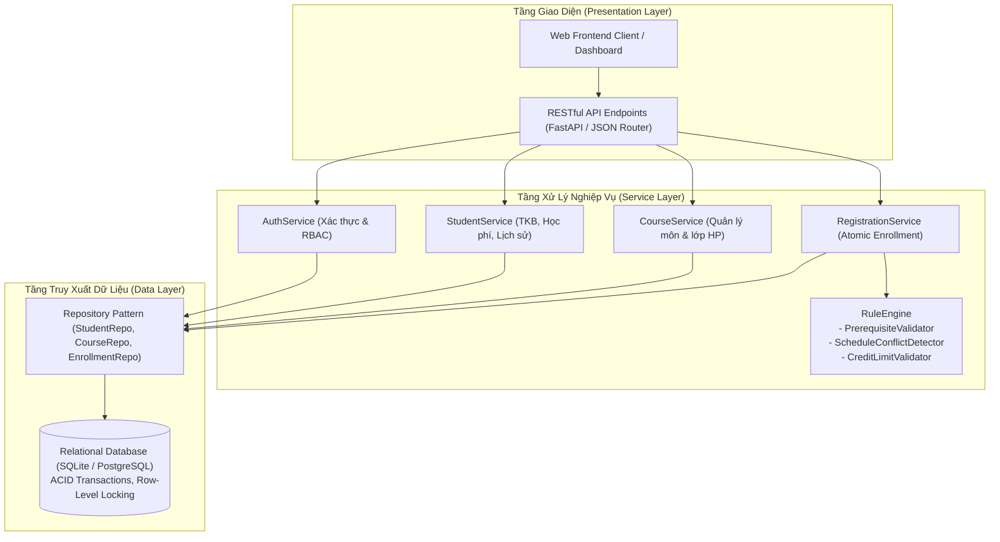
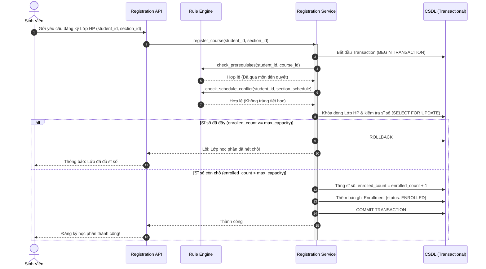
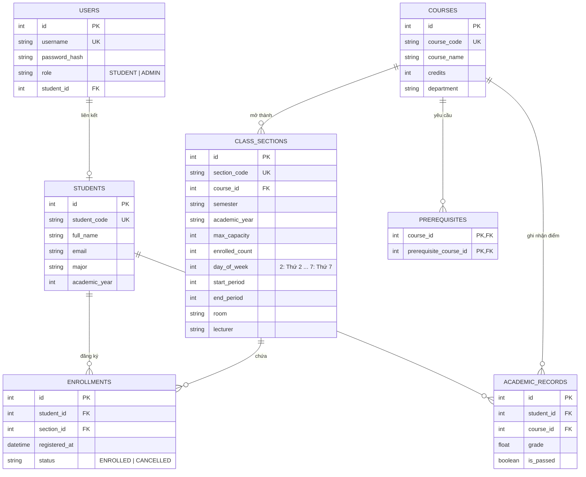
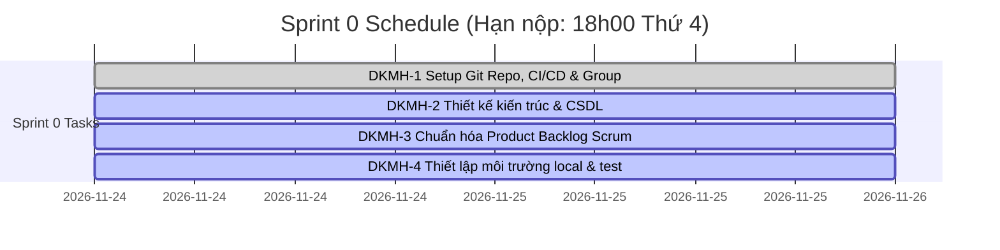

# Tài liệu Thiết Kế Kiến Trúc Hệ Thống & Product Backlog
## Đề tài: Hệ Thống Quản Lý Và Đăng Ký Môn Học (Course Registration & Management System - CRMS)

- **Môn học:** Công nghệ phần mềm (Software Engineering) - Suất 2
- **Nhóm thực hiện:** Nhóm 15
- **Giảng viên hướng dẫn:** Thầy Long Tran
- **Thời gian lập:** 24/11/2026
- **Kho lưu trữ GitHub:** [tranduy123-hue/nhom15-course-registration](https://github.com/tranduy123-hue/nhom15-course-registration)
- **Dự án quản lý Jira:** [Jira Project DKMH (Nhom 15 - Dang ky mon hoc)](https://duygk45.atlassian.net/browse/DKMH)

---

## 1. Bối cảnh & Mục tiêu Đề tài

### 1.1. Bối cảnh bài toán
Đăng ký môn học là một trong những nghiệp vụ cốt lõi, phức tạp và có tải trọng cao nhất tại các trường đại học theo học chế tín chỉ. Vào các đợt mở cổng đăng ký, hàng nghìn sinh viên đồng thời truy cập, dẫn đến các thách thức lớn về:
- **Xung đột tài nguyên đồng thời (Concurrency / Race Conditions):** Hai hoặc nhiều sinh viên cùng đăng ký vào chỗ trống cuối cùng của một lớp học phần.
- **Ràng buộc học vụ nghiêm ngặt:** Kiểm tra môn học tiên quyết (Prerequisites), môn học trước, kiểm tra giới hạn tín chỉ tối thiểu/tối đa trong học kỳ.
- **Trùng thời khóa biểu (Schedule Conflicts):** Không cho phép sinh viên đăng ký hai lớp học phần có tiết học bị trùng lặp hoặc giao nhau.
- **Tính toàn vẹn dữ liệu học tập:** Đảm bảo khi một thao tác đăng ký hoặc hủy môn thành công, sĩ số lớp và lịch học của sinh viên phải được cập nhật tức thời và chuẩn xác theo nguyên tắc ACID.

### 1.2. Mục tiêu dự án
Xây dựng một hệ thống phần mềm quản lý và đăng ký môn học trực tuyến tin cậy, hiệu năng cao, giao diện trực quan, tuân thủ mô hình phát triển phần mềm Agile/Scrum.
- **Sprint 0:** Thiết lập dự án, chuẩn hóa Product Backlog, phân rã Story Points theo Fibonacci, gán mức ưu tiên MoSCoW, nghiên cứu kiến trúc hệ thống và chuẩn bị môi trường phát triển.
- **Sprint 1 & các Sprint tiếp theo:** Phát triển tuần tự các tính năng nghiệp vụ theo Product Backlog đã được phê duyệt.

---

## 2. Thành viên Nhóm & Phân công Trách nhiệm

| STT | Họ và Tên | GitHub Username | Jira Account ID | Vai trò chính |
|:---:|:---|:---|:---|:---|
| 1 | **Trần Duy** (Nhóm trưởng) | `tranduy123-hue` | `712020:1884e774-3176-48ec-b161-851ede819289` | Project Lead, Auth & Core Registration Engine (Xử lý giao dịch đăng ký đồng thời) |
| 2 | **Phan Văn Hào** | `phanvanhao1103-create` | `712020:5f217dbc-6c2b-402b-9545-43a9cc9b46d4` | System Architect & Catalog Management (Tra cứu môn học, Quản lý lớp học phần) |
| 3 | **Lê Quân Bảo** | `lequanbaodepzai` | `712020:36740f29-0924-4582-b1ea-edd227c53b2f` | Business Logic & Rules Engine (Kiểm tra môn tiên quyết, trùng lịch học, xuất báo cáo) |
| 4 | **Phan Thanh Thịnh** | `phanthanhthinhptt27-cmd` | `712020:63b97d05-a561-4ad4-91f0-d9bb1cc6f78e` | Student Services & Enrollment Lifecycle (Hủy môn học, Tra cứu TKB cá nhân & học phí) |

---

## 3. Nghiên cứu Kiến trúc Hệ thống Phần mềm (System Architecture)

### 3.1. Kiến trúc phân tầng (3-Tier Layered Architecture)
Hệ thống được thiết kế theo kiến trúc phân tầng chuẩn mực, tách biệt độc lập giữa tầng giao diện, tầng nghiệp vụ và tầng dữ liệu:

### 3.2. Luồng Nghiệp vụ Đăng ký Học phần (Sequence Flow)
Quá trình đăng ký môn học được thực thi trong một Database Transaction duy nhất để đảm bảo an toàn tuyệt đối trước tình trạng Race Condition:

---

## 4. Mô hình Dữ liệu Quan hệ (Relational Database Schema)

Hệ thống sử dụng các thực thể quan hệ chuẩn hóa (3NF):

---

## 5. Chuẩn hóa Product Backlog theo Scrum

Áp dụng kỹ thuật phân rã User Story theo chuẩn agile:
- **Điểm số độ phức tạp (Story Points):** Dãy số Fibonacci ($1, 2, 3, 5, 8, 13$).
- **Độ ưu tiên MoSCoW:**
  - **Must have:** Bắt buộc phải có để hệ thống hoạt động.
  - **Should have:** Tính năng quan trọng cần có trong bản phát hành chính.
  - **Could have:** Tính năng tăng trải nghiệm người dùng, có thể bổ sung sau.
  - **Won't have:** Chưa triển khai trong phạm vi đồ án đợt này.

### 5.1. Bảng Tổng hợp User Stories (Product Backlog)

| Jira Key | Mã US | Tên User Story | Điểm (SP) | Ưu tiên | Thành viên phụ trách |
|:---:|:---:|:---|:---:|:---:|:---|
| **DKMH-5** | `US1` | Đăng nhập và xác thực phân quyền (Sinh viên / Quản trị viên) | **3 SP** | **Must have** | Trần Duy |
| **DKMH-6** | `US2` | Tra cứu danh mục môn học và danh sách lớp học phần mở | **5 SP** | **Must have** | Phan Văn Hào |
| **DKMH-7** | `US3` | Đăng ký lớp học phần trực tuyến an toàn & tức thời | **8 SP** | **Must have** | Trần Duy |
| **DKMH-8** | `US4` | Tự động kiểm tra điều kiện tiên quyết và kiểm tra trùng lịch học | **5 SP** | **Must have** | Lê Quân Bảo |
| **DKMH-9** | `US5` | Hủy môn học / Rút khỏi lớp học phần đã đăng ký trong thời hạn | **3 SP** | **Should have** | Phan Thanh Thịnh |
| **DKMH-10**| `US6` | Xem thời khóa biểu cá nhân và học phí tạm tính | **3 SP** | **Should have** | Phan Thanh Thịnh |
| **DKMH-11**| `US7` | Quản lý lớp học phần, mở lớp và thiết lập sĩ số tối đa (Admin) | **5 SP** | **Should have** | Phan Văn Hào |
| **DKMH-12**| `US8` | Báo cáo thống kê và xuất danh sách sinh viên đăng ký theo lớp | **5 SP** | **Could have** | Lê Quân Bảo |

**Tổng điểm Story Points của Product Backlog:** **37 Story Points**.

---

### 5.2. Chi tiết Tiêu chí Chấp nhận (Acceptance Criteria) cho từng US

#### `US1` (DKMH-5): Đăng nhập và xác thực phân quyền (3 SP - Trần Duy)
- **User Story:** Là Sinh viên / Quản trị viên, tôi muốn đăng nhập bằng tài khoản được cấp để truy cập vào đúng các chức năng theo vai trò của mình.
- **Acceptance Criteria:**
  - `AC1.1`: Sinh viên đăng nhập đúng tài khoản -> Chuyển đến trang chủ đăng ký học phần của sinh viên.
  - `AC1.2`: Quản trị viên đăng nhập đúng tài khoản -> Chuyển đến trang quản trị hệ thống (mở lớp, xem báo cáo).
  - `AC1.3`: Đăng nhập sai mật khẩu quá 5 lần -> Khóa tài khoản tạm thời hoặc hiển thị cảnh báo lỗi chi tiết.
  - `AC1.4`: Sử dụng mã hóa mật khẩu an toàn (Argon2/Bcrypt) và bảo vệ phiên bằng JWT/Session an toàn.

#### `US2` (DKMH-6): Tra cứu danh mục môn học & lớp học phần mở (5 SP - Phan Văn Hào)
- **User Story:** Là Sinh viên, tôi muốn tìm kiếm và lọc danh sách lớp học phần mở theo mã môn, tên môn, khoa viện hoặc thứ trong tuần để dễ dàng chọn lớp phù hợp.
- **Acceptance Criteria:**
  - `AC2.1`: Cho phép tìm kiếm full-text theo mã môn học hoặc tên môn học (không phân biệt chữ hoa/thường).
  - `AC2.2`: Lọc được danh sách lớp học phần theo học kỳ hiện tại và khoa/viện đào tạo.
  - `AC2.3`: Hiển thị rõ thông tin chi tiết: Sĩ số tối đa, Sĩ số hiện tại, Số chỗ còn lại, Giảng viên, Lịch học, Phòng học.
  - `AC2.4`: Tự động ẩn hoặc đánh dấu cảnh báo lớp đã đầy sĩ số (0 chỗ trống).

#### `US3` (DKMH-7): Đăng ký lớp học phần trực tuyến (8 SP - Trần Duy)
- **User Story:** Là Sinh viên, tôi muốn nhấn nút Đăng ký vào lớp học phần mong muốn để giữ chỗ và ghi nhận vào danh sách học phần của mình ngay lập tức.
- **Acceptance Criteria:**
  - `AC3.1`: Thao tác đăng ký phải diễn ra trong Transaction an toàn, không được vượt quá `max_capacity` của lớp ngay cả khi nhiều sinh viên bấm đồng thời.
  - `AC3.2`: Sau khi đăng ký thành công, số lượng `enrolled_count` của lớp lập tức tăng thêm 1 và hiển thị ngay trên giao diện.
  - `AC3.3`: Không cho phép đăng ký 2 lớp học phần thuộc cùng 1 môn học trong cùng 1 học kỳ.
  - `AC3.4`: Phản hồi kết quả đăng ký cho sinh viên dưới 500ms.

#### `US4` (DKMH-8): Tự động kiểm tra điều kiện tiên quyết & trùng lịch (5 SP - Lê Quân Bảo)
- **User Story:** Là Hệ thống, tôi cần tự động từ chối yêu cầu đăng ký nếu sinh viên chưa hoàn thành môn tiên quyết hoặc lớp mới bị trùng thời gian học với các lớp đã đăng ký trước đó.
- **Acceptance Criteria:**
  - `AC4.1`: Kiểm tra danh sách môn tiên quyết trong bảng `PREREQUISITES`; nếu sinh viên có điểm tổng kết môn tiên quyết `< 5.0` (hoặc chưa học) -> Báo lỗi: "Chưa hoàn thành môn tiên quyết [Mã môn]".
  - `AC4.2`: So sánh thời gian học (Thứ, Tiết bắt đầu, Tiết kết thúc) của lớp học phần dự định đăng ký với tất cả các lớp đã đăng ký trong cùng học kỳ; nếu giao nhau $\ge 1$ tiết -> Báo lỗi: "Trùng lịch học với lớp [Mã lớp đã đăng ký]".
  - `AC4.3`: Kiểm tra tổng số tín chỉ đăng ký không vượt quá mức tối đa quy định (VD: 24 tín chỉ/kỳ).

#### `US5` (DKMH-9): Hủy môn học / Rút khỏi lớp học phần (3 SP - Phan Thanh Thịnh)
- **User Story:** Là Sinh viên, tôi muốn hủy đăng ký lớp học phần đã chọn trong thời gian cho phép để nhường chỗ cho sinh viên khác hoặc điều chỉnh kế hoạch học tập.
- **Acceptance Criteria:**
  - `AC5.1`: Cho phép sinh viên bấm "Hủy đăng ký" đối với các lớp đã đăng ký thành công trong đợt đăng ký còn hiệu lực.
  - `AC5.2`: Khi hủy thành công, trạng thái chuyển thành `CANCELLED` (hoặc xóa bản ghi), sĩ số `enrolled_count` của lớp tự động giảm đi 1.
  - `AC5.3`: Lớp học phần vừa được giải phóng chỗ phải ngay lập tức khả dụng cho sinh viên khác đăng ký.
  - `AC5.4`: Không cho phép hủy môn học khi đợt đăng ký đã đóng.

#### `US6` (DKMH-10): Xem thời khóa biểu cá nhân & học phí tạm tính (3 SP - Phan Thanh Thịnh)
- **User Story:** Là Sinh viên, tôi muốn xem thời khóa biểu trực quan theo tuần và bảng kê học phí tạm tính tương ứng với tổng số tín chỉ đã đăng ký.
- **Acceptance Criteria:**
  - `AC6.1`: Hiển thị ma trận Thời khóa biểu theo dạng lưới tuần (Thứ 2 đến Thứ 7, Tiết 1 đến Tiết 12).
  - `AC6.2`: Tính toán học phí tự động: $\text{Học phí} = \sum (\text{Số tín chỉ} \times \text{Đơn giá tín chỉ})$.
  - `AC6.3`: Cho phép xuất thời khóa biểu hoặc in ra định dạng PDF/hình ảnh.

#### `US7` (DKMH-11): Quản lý lớp học phần & thiết lập sĩ số tối đa (5 SP - Phan Văn Hào)
- **User Story:** Là Quản trị viên / Phòng Đào tạo, tôi muốn tạo mới, sửa đổi lớp học phần, phòng học, giảng viên và điều chỉnh sĩ số tối đa khi có nhu cầu.
- **Acceptance Criteria:**
  - `AC7.1`: Quản trị viên có màn hình quản lý CRUD lớp học phần.
  - `AC7.2`: Cho phép tăng sĩ số tối đa của một lớp đang mở; không cho phép giảm sĩ số tối đa xuống thấp hơn số lượng sinh viên đã đăng ký thực tế.
  - `AC7.3`: Thiết lập thời gian mở cổng và đóng cổng đăng ký học phần cho từng đợt.

#### `US8` (DKMH-12): Báo cáo & xuất danh sách sinh viên theo lớp học phần (5 SP - Lê Quân Bảo)
- **User Story:** Là Giảng viên / Quản trị viên, tôi muốn xuất danh sách sinh viên đã đăng ký chính thức của một lớp học phần ra file Excel/CSV để phục vụ điểm danh và quản lý lớp.
- **Acceptance Criteria:**
  - `AC8.1`: Hiển thị danh sách sinh viên gồm: STT, Mã sinh viên, Họ tên, Lớp sinh hoạt, Email, Ngày giờ đăng ký.
  - `AC8.2`: Hỗ trợ nút xuất dữ liệu ra file Excel (.xlsx) hoặc CSV chuẩn UTF-8 có dấu tiếng Việt.
  - `AC8.3`: Thống kê tỷ lệ lấp đầy của lớp học phần (% số chỗ đã đăng ký trên tổng sĩ số).

---

## 6. Kế hoạch Chi tiết Sprint 0 (Sprint 0 Backlog - 10 SP)

Theo chỉ đạo của Thầy Long Tran, **Sprint 0** là sprint khởi tạo dành riêng cho công tác setup, nghiên cứu kiến trúc, chuẩn bị kho code và phân công nhiệm vụ:

| Jira Key | Nhiệm vụ Sprint 0 | Điểm (SP) | Người phụ trách | Kết quả bàn giao (Deliverables) |
|:---:|:---|:---:|:---:|:---|
| **DKMH-1** | Setup Git Repository trên GitHub và nhóm làm việc | **2 SP** | **Trần Duy** | - Repo GitHub công khai: `nhom15-course-registration` - Thư mời cộng tác gửi cho 3 thành viên - File `README.md`, `.gitignore`, `LICENSE` - Branch protection & quy tắc commit Gitflow |
| **DKMH-2** | Nghiên cứu và thiết kế kiến trúc hệ thống phần mềm | **3 SP** | **Phan Văn Hào** | - Tài liệu kiến trúc 3-Tier Layered Architecture - Thiết kế ERD Database Schema chuẩn 3NF - Giải pháp kỹ thuật xử lý tranh chấp đăng ký (Concurrency Locking) |
| **DKMH-3** | Xây dựng và chuẩn hóa Product Backlog theo chuẩn Scrum | **3 SP** | **Lê Quân Bảo** | - 8 User Stories chi tiết với cấu trúc As a / I want / So that - Thang điểm Fibonacci (3, 5, 8 SP) - Độ ưu tiên MoSCoW rõ ràng - Tiêu chí chấp nhận (AC) dạng Given-When-Then |
| **DKMH-4** | Thiết lập môi trường phát triển local và kiểm thử baseline | **2 SP** | **Phan Thanh Thịnh** | - Khung mã nguồn ứng dụng (Scaffold directory structure) - Cấu hình môi trường ảo, file `requirements.txt` - Bộ kiểm thử mẫu baseline pytest kiểm tra kết nối CSDL và các service |

---

## 7. Quy chuẩn Kỹ thuật & Tiêu chuẩn Bàn giao (Definition of Done - DoD)

1. **Clean Code & Kiến trúc rõ ràng:**
   - Mã nguồn tuân thủ PEP 8 (Python) hoặc tiêu chuẩn ngôn ngữ tương ứng.
   - Phân chia module rành mạch: `models`, `repositories`, `services`, `controllers/api`.
2. **Kiểm thử tự động (Automated Testing):**
   - Mỗi hàm nghiệp vụ (Service) bắt buộc có Unit Test tương ứng.
   - Đạt độ bao phủ kiểm thử (Test Coverage) tối thiểu 80% trên các rule nghiệp vụ quan trọng.
3. **Quản lý phiên bản Git:**
   - Sử dụng định dạng commit chuẩn: `[DKMH-X] Loại commit: Nội dung mô tả` (VD: `[DKMH-7] feat: implement atomic course registration`).
   - Mọi Pull Request phải được thành viên khác review và phê duyệt trước khi merge vào nhánh `main`.
4. **An toàn bảo mật:**
   - Không commit mật khẩu, secret key hay API token lên kho chứa GitHub.
   - Bảo vệ toàn bộ các truy vấn CSDL bằng Prepared Statements / ORM để phòng tránh triệt để lỗi SQL Injection.
